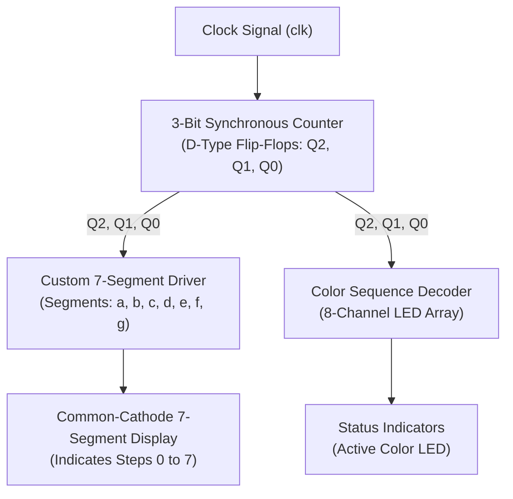

# 3-Bit Synchronous Color Counter & Display Driver

A digital hardware system design implementing a 3-bit synchronous counter, a custom 7-segment display driver, and an independent color LED sequence decoder using D-type flip-flops and combinational logic. The architecture is synthesized and verified using Logisim schematic capture and structural/behavioral Verilog HDL in Intel Quartus Prime.

---

## Architectural Overview

The system operates across three tightly coupled hardware stages synchronized to a common clock signal:



---

## Hardware Specifications

### 1. Synchronous 3-Bit Binary Counter Engine
* Built strictly using three discrete D-type flip-flops (\(Q_2\), \(Q_1\), \(Q_0\)).
* State transitions occur strictly on the positive edge of the clock signal.
* Sequential counting cycle: `000 -> 001 -> 010 -> 011 -> 100 -> 101 -> 110 -> 111 -> 000`.
* **Excitation Equations (minimized via Karnaugh Maps):**
  * \(D_0 = Q_0'\)
  * \(D_1 = Q_1' Q_0 + Q_1 Q_0' = Q_1 \oplus Q_0\)
  * \(D_2 = Q_2 Q_1' + Q_2 Q_0' + Q_2' Q_1 Q_0 = Q_2 \oplus (Q_1 Q_0)\)

### 2. Cyclical Color Code Sequence Decoder
The system maps the 3-bit counter state (\(Q_2 Q_1 Q_0\)) to an 8-LED color status array according to the specified sequence:

| State | Binary (\(Q_2 Q_1 Q_0\)) | Color Code | Active LED Output |
| :---: | :---: | :---: | :---: |
| 0 | `000` | 4 | **Blue** |
| 1 | `001` | 6 | **Pink** |
| 2 | `010` | 1 | **Orange** |
| 3 | `011` | 0 | **Red** |
| 4 | `100` | 4 | **Blue** |
| 5 | `101` | 0 | **Red** |
| 6 | `110` | 0 | **Red** |
| 7 | `111` | 7 | **White** |

*Cyclical sequence indefinitely repeated:* `4 -> 6 -> 1 -> 0 -> 4 -> 0 -> 0 -> 7`

* **Color Decoder Boolean Equations:**
  * \(\text{Blue} = Q_1' Q_0'\)
  * \(\text{Pink} = Q_2' Q_1' Q_0\)
  * \(\text{Orange} = Q_2' Q_1 Q_0'\)
  * \(\text{Red} = (Q_2' Q_1 Q_0) + (Q_2 Q_1' Q_0) + (Q_2 Q_1 Q_0')\)
  * \(\text{White} = Q_2 Q_1 Q_0\)
  * \(\text{Yellow} = 0, \text{Green} = 0, \text{Purple} = 0\) *(Grounded)*

### 3. Custom Combinational 7-Segment Display Driver
Designed without standard decoder ICs (e.g., 7447/7448) to drive an active-high (common-cathode) display:
* \(a = Q_1 + (Q_2 Q_0) + (Q_2' Q_0')\)
* \(b = Q_2' + (Q_1' Q_0') + (Q_1 Q_0)\)
* \(c = Q_2 + Q_1' + Q_0\)
* \(d = (Q_2' Q_0') + (Q_2' Q_1) + (Q_1 Q_0') + (Q_2 Q_1' Q_0)\)
* \(e = (Q_2' Q_0') + (Q_1 Q_0')\)
* \(f = (Q_2 Q_1') + (Q_1' Q_0') + (Q_2 Q_0')\)
* \(g = (Q_2 Q_1') + (Q_2' Q_1) + (Q_2 Q_0')\)

---

## Directory Structure

```
synchronous-color-counter/
|-- synchronous_color_counter.v      # Top-level Verilog HDL module (eee229)
|-- tb_synchronous_color_counter.v   # Verilog testbench simulation driver
|-- circuits/
|   |-- synchronous_color_counter.circ # Complete Logisim schematic implementation
|   `-- seven_segment_driver.circ      # Standalone 7-segment driver schematic
|-- quartus/
|   |-- eee229.qpf                    # Intel Quartus Prime Project File
|   `-- eee229.qsf                    # Quartus Settings and Pin Assignment File
|-- docs/
|   |-- digital_system_design_report.pdf # Comprehensive technical design report
|   `-- rtl_schematic.pdf                # Synthesized RTL gate schematic
|-- .gitignore                        # Standard Quartus and simulation exclusion rules
|-- LICENSE                           # MIT License
`-- README.md                         # Hardware documentation
```

---

## Verification & Simulation

### Verilog Simulation (Icarus Verilog / ModelSim)
To compile and simulate the testbench using Icarus Verilog:

```bash
iverilog -o counter_sim synchronous_color_counter.v tb_synchronous_color_counter.v
vvp counter_sim
```

To inspect generated waveforms using GTKWave:
```bash
gtkwave counter_waveform.vcd
```

### Logisim Simulation
1. Launch **Logisim**.
2. Open `circuits/synchronous_color_counter.circ`.
3. Enable simulation ticks via `Simulate -> Ticks Enabled` (or press `Ctrl+K`) to observe the synchronized color LED sequencing and 7-segment counter progression.

### Intel Quartus Prime Synthesis
1. Launch **Intel Quartus Prime**.
2. Open the project file: `quartus/eee229.qpf`.
3. Run `Processing -> Start Compilation` to perform RTL synthesis, technology mapping, and timing analysis.
4. View the synthesized gate network via `Tools -> Netlist Viewers -> RTL Viewer`.

---

## Author

**Aydan Aydemir**
* GitHub: [@aydanaydemir](https://github.com/aydanaydemir)
* Department of Electrical & Electronics Engineering, Trakya University

---

## License

This project is licensed under the MIT License. See the [LICENSE](LICENSE) file for complete details.
